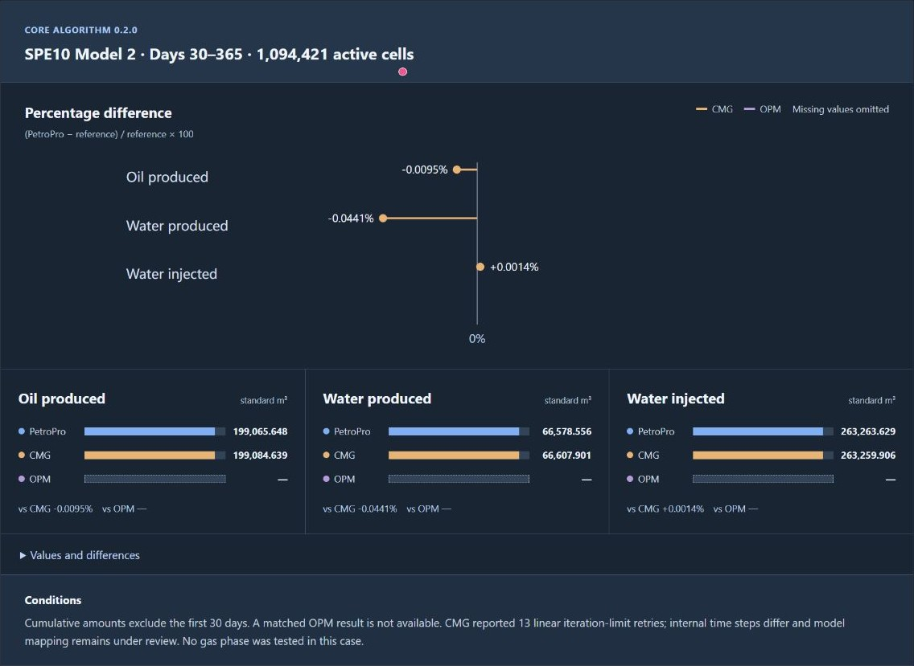
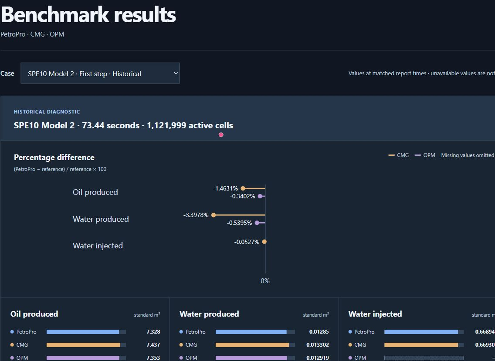

# PetroPro Platform

PetroPro is an upstream oil and gas software platform in development, bringing subsurface data, reservoir simulation and production workflows together. This public repository tracks development, selected validation results and upcoming work. The product source code is not published here.

**Status:** beta development · **Latest recorded milestone:** black-oil core 0.2.0 · **Updated:** 2026-11-09

[Website](https://petropro.app/) · [Benchmark charts](https://petropro.app/benchmark-020.html) · [Development progress](https://petropro.app/progress.html) · [Free case testing](TESTING.md) · [Ask a question](https://github.com/LogicMateCA/petropro-platform/issues)

## Benchmark charts

### Core 0.2.0 · SPE10 Model 2

OPM has no matched result for this case; the graph does not treat missing data as zero. This case has no gas phase.

### Historical candidate · three-simulator comparison

This is an earlier candidate, not core 0.2.0. The three simulators used different well controls; PVT and wellbore mapping remain under review. The short-step result does not establish overall accuracy.

## Project scope

| Area | Direction | Status |
| --- | --- | --- |
| Reservoir simulation | Black-oil simulation, well controls and result analysis | Core baseline and selected cases tested; validation continues |
| Subsurface interpretation | Seismic interpretation, geology, reservoir models and visualization | Development direction; coverage varies by workflow |
| Production and operations | Well and production data, analysis, GIS and operational views | Development direction; end-to-end coverage is not yet established |
| Data and interoperability | OSDU, Energistics, OGC/ISO, SEG and other applicable standards; versioned simulator adapters | Selected OSDU test operations exercised; broad compatibility remains in development |
| AI-assisted workflows | Assistance with data discovery, model preparation and result investigation | In development; subject to verification |
| Business integration | Connections to enterprise systems, including possible ERP integration | Planned |

Statuses describe the scope above, not a promise of complete support for a standard, format or workflow.

## Validation and results

### Black-oil core 0.2.0

The fixed engineering baseline was recorded on **2026-11-08**. This is a version of the **black-oil core algorithm**, not a release version for the whole platform and not field qualification.

| Case | Scope recorded | What it shows |
| --- | --- | --- |
| SPE1 | 300 cells; 3,650 simulated days | The recorded run reached the end of the case. |
| SPE10 Model 2 | 1,094,421 active cells; 365-day result | A large case was run and compared at recorded report times. |
| Zero-water-rate and reopening | Four synthetic cases over 45 days | The tested zero-target interval and restart behavior are limited to these cases. |

[View the comparison charts and case details](https://petropro.app/benchmark-020.html). The charts group PetroPro, CMG and OPM at matched report times where results are available. An unavailable result is not zero. Historical candidates and the 0.2.0 baseline are identified separately.

The SPE10 Model 2 continuation covers days 30–365; it does not include the first 30 days of cumulative production. Internal time steps and some well-control and property mappings have not been fully qualified against the reference. Results apply only to the stated cases and configurations. SPE9 has not been published as a 0.2.0 comparison. No general simulator ranking or field-accuracy claim is implied.

## Development roadmap

**Current priorities**

1. Extend black-oil validation: gas conservation, difficult cells, time-step sensitivity, input mapping and well controls.
2. Add matched cases and document production, injection, pressure, saturation and material balance with comparison conditions.
3. Connect model inputs, simulation results and reporting in an end-to-end workflow.
4. Expand data exchange across applicable industry standards and simulator-specific adapters, recording version and operation coverage.
5. Repeat performance measurements with fixed input, hardware, execution configuration and accuracy criteria.

**Further platform directions** include seismic interpretation, geological modeling, GIS, production workflows and AI assistance. Priorities can change as testing progresses; these are not release-date commitments.

## Version and development record

| Date | Milestone | Status |
| --- | --- | --- |
| 2026-11-08 | Black-oil core 0.2.0 engineering baseline fixed | Selected SPE1, SPE10 and synthetic cases recorded; broader validation open. |
| 2026-11-09 | Public project record established | Documentation and discussion repository; no product source release. |

Earlier solver candidates are research results and are not interchangeable with the fixed baseline. See the [development progress](https://petropro.app/progress.html) for current updates and [results](https://petropro.app/benchmark-020.html) for case-specific scope.

## Feedback and collaboration

We welcome technical feedback, suggestions for public benchmarks and discussion of validation methods. If you have a suitable case and would like to discuss a **free test**, see the [testing guide](TESTING.md) and [open an issue](https://github.com/LogicMateCA/petropro-platform/issues). Please do not post confidential models or company data publicly; we can first discuss a suitable way to share them.

## Repository and rights

This is a public documentation and discussion repository. Product source code and executable releases are not included. No open-source license is granted by this repository. Third-party names are used to identify comparison software; they do not imply affiliation or endorsement.
